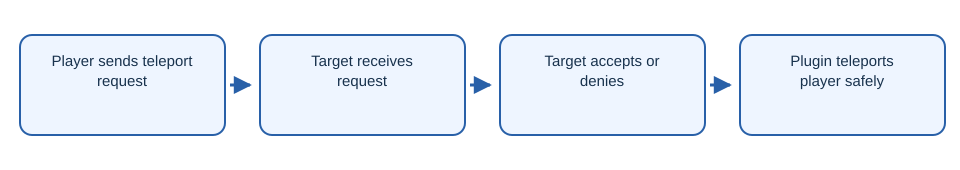

# NeonTPA

Minecraft teleport request plugin with commands and a request interface.

## Workflow

1. Player sends teleport request.
2. Target receives request.
3. Target accepts or denies.
4. Plugin teleports player safely.

## Getting started

Build with `./gradlew build` and install the JAR on a compatible Paper server.

## License

The project code is licensed under AGPL-3.0-only. See [LICENSE](LICENSE).
